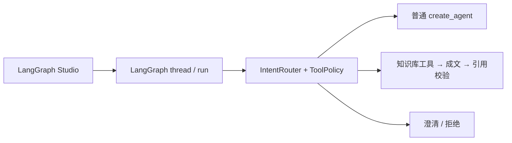

# THar LangGraph MVP

直接通过 `langgraph dev` 启动，在 LangGraph Studio 中对话。
无需项目账号、密码、登录 token 或 Custom Headers。
保留普通对话、知识库目录、Markdown/TXT 上传和问答，所有对话先经过意图路由。



## 启动

已有虚拟环境和 `.env` 时，在项目根目录运行：

```bash
source env/bin/activate
langgraph dev
```

首次安装（Python 3.11+）：

```bash
python3.13 -m venv env
source env/bin/activate
python -m pip install -e '.[dev]'
cp .env.example .env
```

在 `.env` 填写 `DEEPSEEK_API_KEY` 与 `TYPESAFE_API_KEY`，然后运行 `langgraph dev`。
本地生成回答和意图识别仍需要相应模型配置。
可选的 `bash scripts/dev.sh` 固定使用项目虚拟环境、配置和本地 2024 端口，同样自动打开 Studio。

## Studio

启动后打开终端输出的 Studio 链接，或：

<https://smith.langchain.com/studio/?baseUrl=http%3A%2F%2F127.0.0.1%3A2024>

Base URL 为 `http://127.0.0.1:2024`，无需添加认证 Header。
以前填写过项目 `x-api-key` 的话，可从 Connection / Custom Headers 中移除。
Edge/Chrome 提示访问本地网络时选择允许。切换配置后需重启 Server。

选择 `agent` 图，在消息输入中提交用户消息。JSON 输入示例：

```json
{"messages": [{"role": "user", "content": "你好"}]}
```

Studio 创建 thread 并传入 thread_id，Server 负责检查点、历史与原生流式协议。
主图包括 `route_intent`、`agents`、`knowledge`、`clarify` 和 `denied`。
Studio 的图编辑和调试使用 LangGraph 原生功能。

## 知识库

MVP 只有 `default` 知识库，支持 UTF-8 Markdown/TXT，单文件最大 20 MB。
无需登录即可上传：

```bash
curl -X POST http://127.0.0.1:2024/api/v1/knowledge/default/documents \
  -F 'file=@./refund.md'
```

然后在 Studio 询问“知识库里有哪些文档？”或“根据知识库，退款期限是多少？”。
目录读取元数据，不调用 Embedding；正文检索使用本地 BGE + 持久化 Chroma。
首次入库/正文检索若模型不完整，会从 Hugging Face 下载；设备自动选择 CUDA、MPS 或 CPU。
索引和模型路径见 `.env.example`。既有本地文档、模型和索引保留。

当前为单用户本地开发项目，所有调用共用应用固定的本地知识库上下文
（user_id=0、admin 等级、default 租户/知识库），没有登录或 thread 所有权隔离。
这些值用于现有分块 ACL，不接受消息、模型参数或 configurable 改写。

- 分类不可用、未知意图、低置信度只澄清，不调用 Agent。
- 普通对话不注册业务工具；知识库工具仍受意图白名单约束。
- 知识检索保留 ACL、证据阈值与引用校验；每轮使用本轮检索证据。
- 检索失败、无证据、引用缺失或伪造均拒答；未审计草稿不进入消息流或检查点。
- 检索内容是不可信数据，不能覆盖系统策略。

HTTP 端点：`/api/v1/knowledge/default/documents`、`/health/live`、`/health/ready`。
对话使用 LangGraph 原生 `/threads` 与 `/threads/{thread_id}/runs/stream`。
本地健康检查：<http://127.0.0.1:2024/health/ready>。

## 验证

```bash
python -m unittest discover -v
python -m compileall -q langHar tests
```

测试使用 Fake 分类器、模型、Embedding，不调用真实供应商或产生费用。
Bootstrap 在启动时检查意图、Prompt、工具及知识库回答策略的一致性。
