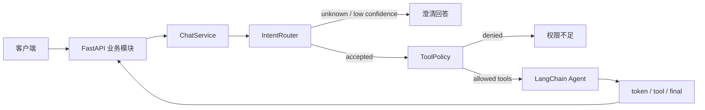

# THar

> 面向服务端的、意图优先的 LangChain Agent 开发脚手架。


THar 帮你把一个能调用 LLM 的 Demo，变成一个可继续扩展的 Agent 服务端：
有登录身份、对话会话、意图路由、工具权限、SSE 流式事件，也有清晰的分层和可替换的外部适配器。

它不只是一段 `create_agent()` 示例，而是一个适合用来手搭 AI 助手、企业内部 Agent、工具型 Agent 和 RAG 应用的起点。

## 为什么是 THar

- **LangChain 开发脚手架**：提供可运行的 FastAPI 服务、组装入口、Agent 执行器和流式 API。
- **意图优先**：用户请求必须先通过意图识别，未知意图、低置信度和识别失败都会故障关闭。
- **工具最小授权**：根据意图与身份等级计算工具集合，模型只能看到当前获授权的工具。
- **真正的服务端上下文**：每次调用显式传入 `session_id`、`user_id`、身份等级和历史消息。
- **完整流式协议**：通过 SSE 输出 `token`、`tool_start`、`tool_end`、`final` 和 `error` 事件。
- **模块化架构**：API 按业务模块组织，编排、能力和外部 SDK 边界明确。
- **测试不烧钱**：测试使用 Fake 识别器和 Fake Agent，不请求真实模型。

## 当前能力

- [x] 服务启动时创建并复用单 Agent
- [x] `invoke()` 非流式调用与 `stream()` 流式调用
- [x] 可信意图识别与低置信度澄清
- [x] 按意图和身份等级管理工具权限
- [x] Cookie 登录、多用户会话隔离
- [x] 对话创建、列表、历史和 SSE 对话接口
- [x] FastAPI lifespan 资源创建与关闭
- [x] 架构边界自动测试

> [!IMPORTANT]
> 当前是便于学习和二次开发的 MVP。账号、登录 Cookie 和对话会话保存在单进程内存中，服务重启后会丢失，不应直接作为生产认证方案。

## 5 分钟启动

### 1. 准备环境

需要 Python 3.11 或更高版本。macOS 自带的 `/usr/bin/python3` 可能仍是 Python 3.9，请先确认版本。

```bash
python3.13 -m venv env
source env/bin/activate
python -m pip install -e .
cp .env.example .env
```

### 2. 配置模型

在 `.env` 中至少填写：

```dotenv
DEEPSEEK_API_KEY=你的_DeepSeek_Key
TYPESAFE_API_KEY=你的_JEV_Token
```

也可使用通用环境变量 `LLM_API_KEY` 和 `JEV_API_KEY`。其他可配置项见 [.env.example](./.env.example)。

### 3. 启动 API

```bash
uvicorn langHar.main:app --reload --host 127.0.0.1 --port 8000
```

启动后打开：

- Swagger 文档：<http://127.0.0.1:8000/docs>
- 存活检查：<http://127.0.0.1:8000/health/live>
- 就绪检查：<http://127.0.0.1:8000/health/ready>

## 核心调用链



1. `JevIntentRecognizer` 只返回意图、置信度和概率。
2. `IntentRouter` 校验未知意图、置信度和识别失败。
3. `ToolPolicy` 根据意图和身份等级计算当前工具集合。
4. LangChain 中间件先过滤模型可见工具，工具执行前再做一次校验。
5. `ChatService` 只持久化用户消息和最终助手回答，不保存内部工具记录。

## 项目结构

```text
langHar/
├── api/                          # FastAPI 接入层，按业务模块组织
│   ├── auth/                    # 登录、Cookie 身份、认证 Schema
│   ├── chat/                    # 对话路由、Schema、SSE
│   ├── session/                 # Agent 对话会话
│   ├── health/                  # 存活与就绪检查
│   ├── app.py                   # FastAPI 应用和 lifespan
│   └── deps.py                  # 跨模块容器契约
├── core/                         # 框架无关数据契约
├── orchestration/                # 意图、Agent、聊天和会话编排
├── capabilities/
│   ├── prompts/                 # Prompt 资产
│   └── tools/                   # 工具实现、注册和权限
├── infrastructure/
│   ├── intent_recognition/      # JEV 意图识别适配器
│   └── llm/                     # LangChain 和模型供应商适配器
├── config/                       # Settings 和环境变量
├── bootstrap.py                  # 唯一 composition root
└── main.py                       # 服务端入口
```

核心原则：

- API 只处理 HTTP、Cookie、Pydantic Schema 和 SSE。
- Orchestration 是唯一流程所有者，不依赖 FastAPI 或具体模型 SDK。
- Infrastructure 实现外部端口，但不控制业务流程。
- `bootstrap.py` 是唯一同时组装编排、能力和基础设施实现的地方。

更完整的长期架构、RAG 边界和开发约束见 [AGENTS.md](./AGENTS.md)。

## API 快速体验

当前 MVP 内置两个演示账号：

```text
admin / password  # admin，可使用天气和计算工具
tony / 123456     # L2，可使用天气工具
```

### 1. 登录并保存 Cookie

```bash
curl -i -c cookies.txt \
  -H 'Content-Type: application/json' \
  -d '{"username":"admin","password":"password"}' \
  http://127.0.0.1:8000/api/v1/users/login
```

### 2. 创建对话会话

```bash
curl -b cookies.txt -X POST \
  http://127.0.0.1:8000/api/v1/conversations
```

### 3. 流式调用 Agent

将 `{conversation_id}` 替换为上一步返回的 ID：

```bash
curl -N -b cookies.txt \
  -H 'Content-Type: application/json' \
  -d '{"content":"北京今天天气怎么样？"}' \
  http://127.0.0.1:8000/api/v1/chat/{conversation_id}/messages
```

## 在代码中调用

在 Web 服务的 startup/lifespan 阶段创建一次：

```python
from langHar.bootstrap import create_agent_service
from langHar.config import Settings

agent_service = create_agent_service(Settings.from_env())
```

非流式调用：

```python
from langHar.core.agent import AgentContext, IdentityLevel

final_event = await agent_service.invoke(
    "北京天气怎么样？",
    context=AgentContext(
        session_id="session-123",
        user_id=0,
        identity_level=IdentityLevel.ADMIN,
        history=(),
    ),
)
```

`invoke()` 返回最终 `AgentEvent`；`stream()` 返回 token、工具和 final 事件。所有调用都必须传入非空 `session_id`。

## 如何扩展

### 新增意图

1. 在 `INTENT_CATALOG` 中增加意图和 criteria。
2. 在 Prompt Registry 中增加对应系统提示词。
3. 在 Tool Catalog 中声明可用工具和身份等级。
4. 增加高置信度、低置信度和越权测试。

### 新增工具

1. 在 `capabilities/tools/builtin` 中实现工具。
2. 加入 Tool Registry。
3. 在 Tool Catalog 中配置意图白名单和身份权限。
4. 为未授权调用增加故障关闭测试。

### 替换模型或外部服务

实现已有端口，把具体 SDK 限制在 `infrastructure` 内，然后在 `bootstrap.py` 中替换组装。不需要修改编排流程。

## Roadmap

- [ ] 数据库用户、密码哈希和可持久化登录会话
- [ ] 持久化对话会话与多 worker 支持
- [ ] RAG 知识入库、检索权限和可追溯引用
- [ ] Skill 加载与 MCP 能力
- [ ] 多模型网关、重试与降级
- [ ] OpenTelemetry / LangSmith 追踪与 Prometheus 指标
- [ ] 在真实需求出现后引入多 Agent 编排

## 验证

后端测试不调用真实 JEV、LLM、Embedding 或 Reranker：

```bash
python -m unittest discover -v
python -m compileall -q langHar tests
```

## 一起建设

THar 希望成为一个可以读懂、可以手改、也可以逐步用到真实项目的 LangChain 服务端脚手架。

如果你也在做 Agent、RAG、Tool Calling、MCP 或多模型编排，欢迎：

- 提交 Issue 分享真实使用场景和架构问题。
- 通过 Pull Request 增加工具、适配器、测试或文档。
- 在保持安全边界的前提下，共同打磨一个真正好用的 Agent 工程起点。

第一次参与请先阅读 [贡献指南](./CONTRIBUTING.md)。每个 Pull Request 都会通过后端测试、架构边界检查和前端构建检查。

如果这个方向对你有用，可以收藏项目跟进 Roadmap，也欢迎把你实际遇到的问题带回来一起解决。

## License

THar 使用 [MIT License](./LICENSE) 开源。
